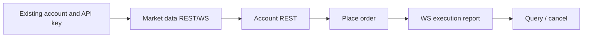

# Trading workflow

This workflow assumes that the trading account has already been created. It covers API-key binding, market and account queries, order placement, and order cancellation against the production API.

For a new account, complete [account onboarding](../authentication/onboarding.md) first. To run the trading example, save the [sample script](mainline-script.md) as `trading-mainline.py` and provide the API credentials returned during onboarding:

> **Live trading warning:** `--with-order` submits and cancels a real order on the production API. Run the default read-only command first and verify the selected account and symbol before enabling this option.

```bash
pip install eth-account base58 cryptography pynacl websocket-client
export RWA_ACCOUNT_ID="0x..."
export RWA_API_KEY="ed25519:..."
export RWA_SECRET_B58="..."
# Optional VIP REST host (same paths / signing as api-trade).
# To-B partners: contact RWA Perp to obtain a dedicated Base URL first.
# export B2B_API_BASE="https://api-vip.rwaperp.xyz"
python3 trading-mainline.py
python3 trading-mainline.py --with-order   # requires sufficient USDC for the current min_notional
```



| Step | Endpoint | Auth |
|------|----------|------|
| 1 | `GET /v1/get_account` | None |
| 2 | `GET /v1/public/futures/{symbol}` | None |
| 3 | WS `{symbol}@ticker` | None |
| 4 | `GET /v1/client/info` / `holding` / `positions` | RWA |
| 5 | `POST /v1/order` | RWA |
| 6 | WS `executionreport` | RWA |
| 7 | `GET /v1/orders` → `DELETE /v1/order` | RWA |

---

## API-key prerequisite

The recommended setup is to bind an API key during [account onboarding](../authentication/onboarding.md), store the returned credentials securely, and pass them to the trading example through `RWA_ACCOUNT_ID`, `RWA_API_KEY`, and `RWA_SECRET_B58`.

The sample script also accepts `EVM_PRIVATE_KEY` as a fallback for an existing account. In that mode it generates and binds a temporary Ed25519 key pair for the current process. It does not create a missing trading account or print credentials for later reuse.

To bind a key manually, call `POST /v1/dex_api_key` using EIP-712 `AddDexApiKey`. The public-key field is **`key`**, and `"chainType":"EVM"` is included in the submitted message but not in the EIP-712 signature. See [Account onboarding](../authentication/onboarding.md) for the complete signing domain and example.

Provide these values to the trading example:

```
RWA_ACCOUNT_ID=0x...
RWA_API_KEY=ed25519:...
RWA_SECRET_B58=...
```

---

## Look up `account_id`

**Request**

```http
GET /v1/get_account?address=0xYourWallet&broker_id=rwaperp_xyz
```

**Response**

```json
{
  "success": true,
  "data": {
    "user_id": 1379874,
    "account_id": "0x17e17444027645d8df015b395b4318bf8ec3d7a3b60ed71a06053b6703c4d0f7"
  },
  "timestamp": 1781628890720
}
```

---

## Fetch a market snapshot

**Request**

```http
GET /v1/public/futures/PERP_ETH_USDC
```

**Response `data` (excerpt)**

```json
{
  "symbol": "PERP_ETH_USDC",
  "mark_price": 1777.32,
  "index_price": 1777.54,
  "est_funding_rate": 0.0001,
  "open_interest": 11101.18,
  "24h_volume": 15111.6
}
```

Before placing an order, use `GET /v1/public/info` to obtain the current `base_tick`, `quote_tick`, and `min_notional` values for the symbol.

---

## Query account, balance, and positions

The following requests require the `RWA-*` headers described in [Request signing](../authentication/request-signing.md):

```http
GET /v1/client/info
GET /v1/client/holding
GET /v1/positions
```

**Response `data` (excerpt)**

**Holding response `data`**

```json
{"holding":[{"token":"USDC","holding":0.588396,"frozen":0.0,"pending_short":0.0}]}
```

**Positions response `data`**

`rows` is empty when the account has no open positions; the response still includes account summary fields.

```json
{"free_collateral":0.588396,"account_value":0.588396,"rows":[]}
```

---

## Place an order

**Method and path**

```http
POST /v1/order
```

**Request body** (the serialized body must exactly match the bytes covered by the RWA signature)

```json
{
  "symbol": "PERP_ETH_USDC",
  "side": "BUY",
  "order_type": "POST_ONLY",
  "order_price": 888.53,
  "order_quantity": 0.0114,
  "client_order_id": "rwa-mainline-abc123"
}
```

| Field | Description |
|-------|-------------|
| `order_type` | `LIMIT` / `MARKET` / `POST_ONLY` / `IOC` / `FOK`, etc. |
| `order_price` | Required for limit-type orders; precision = `quote_tick` |
| `order_quantity` | Precision = `base_tick`; `price × qty ≥ min_notional` |

**Response `data` (success)**

```json
{
  "order_id": 123456789,
  "client_order_id": "rwa-mainline-abc123",
  "symbol": "PERP_ETH_USDC",
  "status": "NEW"
}
```

**Common errors**

| Code | Meaning |
|------|---------|
| `-1101` | Insufficient margin; available USDC is below the required `min_notional` |
| `-1104` | `order_quantity` is not aligned to `base_tick` |

---

## Query and cancel orders

`GET /v1/orders` and `GET /v1/trades` **are not the same dataset**:

| Endpoint | What it is | After a fill |
|----------|------------|--------------|
| `/v1/orders?status=NEW` | **Unfilled resting orders** | Disappears from here once filled |
| `/v1/orders?status=FILLED` or `COMPLETED` | Orders (filled and cancelled) | Found here |
| `/v1/trades` | **Individual fills** (one order can have several) | Available in trade history |
| `/v1/order/{order_id}` | A single order by id | Any status |

`status` values: `NEW` / `PARTIAL_FILLED` / `FILLED` / `CANCELLED` / `REJECTED`. The composite value `INCOMPLETE` means resting orders (`NEW` + `PARTIAL_FILLED`), and `COMPLETED` means finished orders (`FILLED` + `CANCELLED`). A query with `status=NEW` returns only orders that are still in that state when the request is processed.

**Request — query open orders**

```http
GET /v1/orders?symbol=PERP_ETH_USDC&status=NEW
```

**Response `data`**

```json
{
  "rows": [
    {
      "order_id": 123456789,
      "symbol": "PERP_ETH_USDC",
      "side": "BUY",
      "type": "POST_ONLY",
      "price": 888.53,
      "quantity": 0.0114,
      "status": "NEW"
    }
  ],
  "meta": {"total": 1, "records_per_page": 25, "current_page": 1}
}
```

**Request — cancel** (the signed DELETE path **includes the query string**; the body is empty)

```http
DELETE /v1/order?symbol=PERP_ETH_USDC&order_id=123456789
```

**Response `data`**

```json
{"order_id": 123456789, "status": "CANCELLED"}
```

**To change a price or quantity, cancel the order and place a new one.** `PUT /v1/order` is not a general-purpose amend endpoint. To change the side, symbol, `order_type`, tag, or similar fields, use `DELETE /v1/order` followed by `POST /v1/order`.

`PUT /v1/order` allows only these two fields to be changed:

- `order_price`
- `order_quantity`

`order_id` / `symbol` / `side` / `order_type` must match the original order exactly; they are required and must be sent unchanged. Including extra fields from the GET response, such as `status` or `executed_quantity`, or changing the type or side, causes the API to return the server message `You can not change other order info.`

**Method and path**

```http
PUT /v1/order
```

**Request body**

```json
{
  "order_id": 123456789,
  "symbol": "PERP_ETH_USDC",
  "side": "BUY",
  "order_type": "POST_ONLY",
  "order_price": 900.0
}
```

Use the original order's `order_type` (if the original was `POST_ONLY`, still send `POST_ONLY`). The sample workflow does not amend orders.
